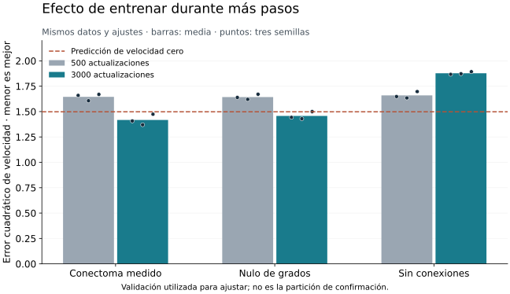

# Bitácora de BIONN / V1NN

Registro acumulativo de experimentos, resultados, hipótesis, retoques y decisiones.
Las reflexiones son conclusiones técnicas resumidas con evidencia y limitaciones.
Un resultado negativo se conserva; una hipótesis no se presenta como observación.

## Cómo mantenerla

Cada entrada debe indicar fecha, objetivo, revisión del código, datos y semillas,
comandos/configuración, resultados, interpretación, límites y próximo paso.
Enlazar los JSON de métricas y distinguir resultados ejecutados de trabajo propuesto.
No guardar credenciales, datos crudos o pesos en GitHub. Añadir correcciones con fecha,
sin borrar resultados anteriores para mejorar retrospectivamente la narrativa.

## 2026-11-09 — 001. Arranque autónomo y reproducción

**Objetivo.** Convertir el prototipo existente en un piloto reproducible que permita
iterar con GPU y conservar el historial del trabajo.

**Punto de partida.** Commit `ad5468fadef647999d0ed23c9c3dce832ac049be`.
La pregunta científica sigue siendo la especificidad del cableado de V1; no se
cambia a JEPA ni se introduce un encoder preentrenado.

**Ejecutado.** Los 20 tests originales pasan. Los smoke tests de 25 actualizaciones
reproducen los errores anteriores en Python 3.12.3 / PyTorch 2.14.1+cu130, usando CPU:

| Objetivo | Error en datos nuevos | Referencia |
| --- | ---: | ---: |
| Movimiento | 1.57416689 | Velocidad cero: 1.53125000 |
| SSL sensorial | 0.00257047 | Persistencia: 0.00060486 |

**Reflexión.** Una ejecución sin errores no demuestra aprendizaje útil. Antes de
comparar conectomas hay que establecer una tarea temporal resoluble y controles
que impidan explicar el resultado por una imagen aislada.

**Acceso y recursos.** Modal conectado y token verificado; credenciales fuera del
repositorio con permisos locales 0600. Máximo autorizado para la primera ronda:
50 USD. Ningún coste GPU se había generado al redactar esta entrada. El límite
económico se lleva como presupuesto operativo; no se ha cambiado la facturación
global de la cuenta. Cada campaña tiene límites explícitos de tiempo y concurrencia.

## 2026-11-09 — 002. Importación real de MICrONS

**Ejecutado.** `python scripts/prepare_microns.py`, descarga de las dos fuentes
fijadas por el importador, comprobación de hashes de blobs y manifiesto SHA256.
Informe: [microns_import.json](../reports/microns_import.json).

| Propiedad | Valor |
| --- | ---: |
| Neuronas | 1.357 |
| Parejas dirigidas | 78.953 |
| Sinapsis incluidas | 146.711 |
| Excitadoras / inhibidoras | 1.191 / 166 |
| Signos desconocidos | 0 |
| Autapsis / neuronas aisladas | 0 / 0 |

Hay posiciones transformadas y tipos generales; no hay metadatos de capa. No
llamar «preservador de capas» a los nulos de este conjunto. La retención de
conexiones de frontera no puede estimarse con esta exportación interna. Importar
el grafo no completa la auditoría fisiológica, de licencia ni de correspondencias
funcionales. Los datos crudos y el NPZ permanecen fuera de GitHub.

## 2026-11-09 — 003. Piloto temporal y primer resultado

**Retoques.** Se añaden `scripts/pilot.py` y `v1nn.benchmark`: particiones
deterministas de entrenamiento y validación, hashes, calibración fija calculada
solo con entrenamiento, semillas, métricas de error vectorial, checkpoints y
controles estático, historia lineal, GRU, CNN temporal, conectoma, sin aristas,
reinicio de estado, reservorio y nulo que conserva grados dirigidos.

La CNN temporal opera sobre los mismos sensores fijos. Una referencia analítica
de correlación de píxeles comprueba por separado que la tarea tiene solución;
no es una comparación de arquitectura igualada. El nulo de grados aún no conserva
tipo y distancia. El generador usa velocidades conocidas y texturas nuevas;
todavía no evalúa generalización a velocidades fuera del entrenamiento.

**Prueba contra atajos.** Para cada una de 16 texturas se construyen ocho historias
con movimientos diferentes y exactamente el mismo fotograma final. Las etiquetas
están balanceadas. Un predictor estático no puede identificar el movimiento de
cada historia a partir de esa imagen común.

**Ejecutado.** GRU, semilla 7, 500 actualizaciones, 2.048 clips de entrenamiento,
512 de validación, 8 fotogramas, grid 4, 64 unidades, CPU:

| Partición | Error cuadrático vectorial | Velocidad cero |
| --- | ---: | ---: |
| Validación de desarrollo | 0.44454679 | 1.49804688 |
| Historias con final idéntico | 0.42165637 | 1.50000000 |

Tiempo del runner: 15,86 s (excluye arranque de Python). Informe:
[pilot_gru_cpu_seed7.json](../reports/pilot_gru_cpu_seed7.json).

**Interpretación.** Una referencia temporal aprende con esta interfaz. Es una
prueba de viabilidad de la tarea, no evidencia de ventaja biológica. Una semilla
y validación de desarrollo no son un resultado confirmatorio. No se usa un test
final para seleccionar hiperparámetros.

**Verificación del software.** 26 tests pasan, incluidos controles de historia,
separación de particiones, calibración sin filtración, repetibilidad y checkpoint.
La definición de Modal carga sin lanzar GPU. Ejecución remota pendiente al cerrar
esta entrada; se añadirá su resultado en una entrada posterior.

**Siguiente paso.** Medir coste/rendimiento real de GPU y comparar varias semillas
con controles emparejados. No escalar por reducir únicamente la pérdida de
entrenamiento. Mantener el techo de gasto acumulado y registrar fallos completos.

## 2026-11-09 — 004. Modal operativo y 24 ensayos completos en T4

**Incidencia conservada.** El primer arranque creó la imagen, pero Modal rechazó
la T4 por ausencia de método de pago. App `ap-5KveeqwTQlpsF6VClkQAtI`, detenida
sin lanzar GPU. El usuario añadió el método de pago y el siguiente intento funcionó.

**Revisión ejecutada.** `517e62448524e457e51d2536cd57d3c2d9909d25`, árbol limpio.
Python 3.12.10, PyTorch 2.14.1+cu130, NumPy 2.5.4, CUDA 13.0, Tesla T4.
La identidad del commit remoto está en `campaign.json`; los informes individuales
registran además el hash de los archivos Python. Checkpoints recuperados localmente
y conservados en Modal; no se publican en GitHub.

**Referencias, tres semillas (7/8/9), 500 pasos, batch 64.** Mismos 2.048 clips
de entrenamiento y 512 de validación. Misma calibración de sensores para todas.
Los valores ± son desviaciones estándar entre entrenamientos, no intervalos de
confianza, ni variabilidad entre animales. EPE es error euclídeo de velocidad.

| Modelo | Error cuadrático validación | EPE validación | Error cuadrático, final idéntico |
| --- | ---: | ---: | ---: |
| GRU | 0.43005 ± 0.01903 | 0.56185 | 0.42689 |
| CNN temporal | 0.64233 ± 0.01549 | 0.71636 | 0.64539 |
| Estático | 1.52809 ± 0.01459 | 1.21212 | 1.53245 |
| Historia lineal | 1.79634 ± 0.01880 | 1.27127 | 1.72191 |
| Velocidad cero | 1.49805 | 1.20630 | 1.50000 |

Informes: [GPU](../reports/gpu_reference/campaign.json),
[reproducción CPU](../reports/cpu_reference/summary.json).
La campaña GPU duró 52,25 s dentro de la función; el total de los runners CPU
fue 54,69 s. No son tiempos completos de facturación ni un benchmark de hardware
aislado; incluyen preparaciones y, en la campaña, commits al volumen.

**MICrONS, mismos datos y tres semillas, 500 pasos, batch 64, alpha 0,3.**

| Modelo | Error cuadrático validación | EPE validación | Error cuadrático, final idéntico |
| --- | ---: | ---: | ---: |
| Conectoma medido | 1.64505 ± 0.03368 | 1.23104 | 1.70956 |
| Sin aristas | 1.65978 ± 0.03309 | 1.23637 | 1.72310 |
| Estado reiniciado | 1.61528 ± 0.03641 | 1.23383 | 1.65848 |
| Nulo de grados dirigidos | 1.64327 ± 0.02559 | 1.23067 | 1.70920 |

[Campaña MICrONS](../reports/gpu_microns/campaign.json): 12 ensayos completos,
191,53 s dentro de la función. No hay mejora frente a velocidad cero. Medido y
nulo quedan prácticamente iguales en este régimen. No se interpreta como
refutación general de los conectomas: interfaz, dinámica y optimización son
limitaciones sustanciales. Este nulo conserva grados, **no tipos ni distancias**.

**Exploración previa de CPU.** Se conservan [cuatro ensayos](../reports/cpu_microns_short/summary.json)
de la semilla 7, 100 pasos y batch 16. Se detuvo la continuación de esa campaña
cuando estuvo disponible la GPU; no se presentan las otras semillas como ejecutadas.
El nulo realizó 394.765 intercambios en 574.595 intentos y cambió el 83,95 % de las
aristas. Esto mide cambio efectivo, no mezcla uniforme. Auditoría estructural:
[microns_audit.json](../reports/microns_audit.json).

**Reflexión y siguiente retoque.** La GRU reduce mucho su pérdida de entrenamiento;
MICrONS con alpha 0,3 permanece cerca del nivel trivial. Antes de aumentar tamaño
o presupuesto, se expone `--alpha` para probar si una actualización más rápida
facilita interacciones temporales. Mantener los mismos datos, signos, routing,
topología y presupuesto entre medido, nulo y control sin aristas. Este ajuste es
exploratorio sobre validación; no modifica retrospectivamente el protocolo final.

**Comprobaciones y gasto.** 27 tests pasan, incluida la propagación de alpha y su
efecto sobre la memoria individual. Se consultó facturación antes y después; las
cifras inmediatas pueden llegar con retraso. Se mantienen 6 USD de reservas
conservadoras para los tres intentos, no 6 USD de gasto medido. El techo sigue
siendo 50 USD acumulados. [Registro de cómputo](../reports/compute_ledger.json).

## 2026-11-09 — 005. Cambio de dinámica: resultado negativo

**Hipótesis del ajuste.** Probar si la fuga lenta del estado dificultaba aprovechar
interacciones temporales. Cambiar únicamente alpha de 0,3 a 1, manteniendo datos,
routing, semillas 7/8/9, optimizador, 500 actualizaciones y batch 64. Medido, nulo
de grados y control sin aristas reciben el mismo ajuste.

**Ejecutado.** Commit `85dd523510ee696e4ade7f743e3b1ba5529740a8`. App
`ap-VmT53KXfCtatqKuVgES0GX`, campaña `20261109T184111Z-46d08176`: los nueve ensayos
terminan sus 500 pasos en T4. Tiempo total dentro de la función: 222,58 s.
[Informes y configuración](../reports/gpu_alpha1/campaign.json).

| Modelo | Error cuadrático validación, alpha 0,3 | Error cuadrático validación, alpha 1 |
| --- | ---: | ---: |
| Conectoma medido | 1.64505 ± 0.03368 | 1.81862 ± 0.06452 |
| Sin aristas | 1.65978 ± 0.03309 | 1.81132 ± 0.04008 |
| Nulo de grados | 1.64327 ± 0.02559 | 1.81023 ± 0.05291 |

Con alpha 1, los errores en historias de final idéntico son 1,83493, 1,84479 y
1,85806, respectivamente. También empeoran respecto al régimen original.

**Decisión.** Conservar alpha 0,3 como valor por defecto. No hay evidencia de que
el ajuste propuesto resuelva el aprendizaje de movimiento en este régimen. La
opción permanece disponible para reproducir el resultado, sin presentarla como
una mejora. No aumentar escala o presupuesto solo por preferencia por el modelo.

**Reflexión sobre ingeniería.** Se exploraron localmente operaciones alternativas
para el cálculo recurrente. Una multiplicación dispersa fue más lenta que la
acumulación por arista en el microbenchmark; una matriz densa enmascarada fue más
rápida, pero requiere memoria cuadrática y el resultado no es un benchmark de
entrenamiento completo. No se cambió el núcleo por esa observación aislada.

**Estado al cerrar esta primera ronda.** 33 ensayos GPU completos (12 referencias,
12 MICrONS originales, 9 con alpha 1), además de 16 ensayos comparativos CPU
conservados y las pruebas de integración. 27 tests pasan. Los cuatro intentos de
app de BIONN figuran detenidos, con cero tareas activas. No queda una campaña GPU
ejecutándose ni se ha programado una automatización recurrente.

La consulta de facturación registra 0,11488725 USD en ejecuciones efímeras del
workspace; es una fotografía provisional, no una factura final atribuida al
proyecto. Se conservan 8 USD de reservas operativas para cuatro intentos y 42 USD
de margen frente al máximo autorizado de 50 USD. No reiniciar ese presupuesto en
la siguiente sesión.

**Próximos experimentos propuestos, todavía no ejecutados.**

1. Comprobar sobreajuste deliberado de un conjunto muy pequeño y medir el error
   completo de entrenamiento para separar capacidad de optimización.
2. Revisar escalas de gradientes, ganancia recurrente y representación sensorial,
   manteniendo controles emparejados. Reservar conjuntos nuevos para confirmar
   cualquier decisión tomada con esta validación.
3. Solo después, comparar nulos que conserven tipo y distancia y calibrar una
   interfaz de entrada más defendible. No reclamar especificidad anatómica con el
   nulo de grados actual ni generalización a otros animales.

## Entrada 006 — 2026-11-09: diagnóstico de capacidad con 32 ejemplos (plan previo)

**Motivación.** Las tres semillas del conectoma a 500 actualizaciones no mejoran
la predicción cero en validación; quitar la fuga (`alpha=1`) empeora el resultado.
No repetir ese ajuste sin evidencia nueva. Antes de buscar una ventaja anatómica,
comprobar que el modelo puede ajustar un conjunto deliberadamente pequeño.

**Hipótesis y criterio.** Si conectoma y control sin aristas reducen el MSE de
entrenamiento completo por debajo del 1 % de su referencia cero, tienen capacidad
para memorizar 32 clips bajo este optimizador. Esto no demuestra capacidad para
la tarea general ni que 500 pasos basten con 2048 clips. Si fallan mientras GRU
aprende, investigar representación/gradientes antes de ampliar el estudio del grafo.
La lectura estática controla que memorizar ejemplos no equivale a usar movimiento.

**Diseño fijado antes de lanzar.** MICrONS v1718, 32 clips de entrenamiento,
512 de validación y las mismas 16 texturas contrafactuales × 8 direcciones; filtros
4×4, 8 fotogramas, alpha 0,3. Modelos GRU, estático, conectoma y sin aristas,
semillas 7/8/9, 1500 actualizaciones Adam, lr 0,003, batch 64. Datos y calibración
compartidos dentro de esta campaña. Cambiar el tamaño del generador cambia las
texturas, etiquetas y calibración: no asumir que estos 32 clips son un subconjunto
de los 2048 anteriores ni comparar directamente ambos errores de validación.
Medir todo el entrenamiento después del último paso, además de validación e
historias contrafactuales. Registrar normas de gradiente y cambio de parámetros.

**Ejecución y coste.** Una campaña T4 secuencial de 12 ensayos, límite suave
1200 s y duro 1800 s, sin reintentos; reserva previa de 2 USD. No hay aplicaciones
BIONN activas al preparar este plan. El contador agregado de aplicaciones efímeras
de Modal es 0,10324261 USD, no una factura final ni un desglose exclusivo del
proyecto; se mantienen todas las reservas anteriores. Resultados pendientes.

**Continuidad nocturna.** Por petición del usuario se ha creado una revisión en
este chat cada dos horas durante la noche del 9 al 10 de noviembre, con límite
el 10 a las 08:00 Europe/Paris. Consultará estado, bitácora y presupuesto antes de
actuar; no duplicará campañas activas ni repetirá hipótesis descartadas sin motivo.
El máximo sigue siendo 50 USD acumulados para toda la ronda.

### Diagnóstico adicional fijado durante la campaña 006

La reevaluación en CPU de nueve checkpoints de la campaña original confirma MSE
medio de entrenamiento: GRU 0,044127, conectoma 1,389131 y sin aristas 1,422518.
Se reconstruyeron exactamente datos/calibración y se reprodujo la validación
con diferencias numéricas inferiores a la tolerancia fijada (relativa 1e-5,
absoluta 1e-6). No hubo entrenamiento adicional. El grafo local tiene el mismo
SHA-256 que el usado en Modal. Archivo: `reports/retrospective_training.json`.

El primer ensayo pequeño del conectoma baja a MSE 0,013758 en entrenamiento
pero sube a 3,022269 en validación; es parcial, no una conclusión de tres semillas.
Esto motiva una prueba independiente **sin gasto GPU**: congelar los núcleos ya
entrenados de la campaña original (2048 clips, 500 pasos) y resolver directamente
la lectura lineal mediante mínimos cuadrados/ridge. Comparar conectoma y sin
aristas, semillas 7/8/9, con penalizaciones fijadas ahora: 0, 1e-4, 1e-2, 1 y 100.
Centrar y escalar cada estado final usando exclusivamente entrenamiento; el sesgo
no se penaliza. Las penalizaciones se aplican al error cuadrático medio por clip,
no a su suma. Resolver en float64 y registrar rango/tolerancia numérica.

Si solo mejora entrenamiento, hay margen de optimización de la lectura pero no
se ha mostrado una representación que generalice. Si mejora validación, comparar
ambos controles con el mismo presupuesto de selección y confirmarlo después
con particiones nuevas. La selección entre penalizaciones sigue siendo ajuste
sobre validación; no es un test final ni evidencia aislada de ventaja anatómica.
No modificar el núcleo ni descartar puntos de regularización desfavorables.

### Resultado de la campaña 006

Completados **12/12 ensayos de 1500 pasos**, T4, 224,42 s de función. Revisión
`3f183683d7d696adb41129983396b5ad89801949`; aplicación
`ap-jTYXYN8vV4Zu4BraLAilMz`, campaña `20261109T190712Z-eb2cacc2`.
Reportes íntegros en `reports/gpu_tiny_fit/`; checkpoints privados recuperados.
Ninguna aplicación BIONN permanece activa al comprobar el cierre.

| Modelo | MSE entrenamiento, media ± DE | MSE validación, media ± DE | MSE contrafactual, media ± DE |
| --- | ---: | ---: | ---: |
| GRU | 3,12e-13 ± 1,81e-14 | 2,10916 ± 0,02565 | 2,03630 ± 0,02296 |
| Estático | 0,02115 ± 0,00285 | 10,34310 ± 0,43679 | 11,84951 ± 0,28159 |
| Conectoma | 0,00459 ± 0,00794 | 2,98154 ± 0,08968 | 2,38177 ± 0,02737 |
| Sin aristas | 0,00648 ± 0,00557 | 2,98249 ± 0,06466 | 2,37420 ± 0,04162 |
| Velocidad cero | 1,43750 | 1,49805 | 1,50000 |

**Observación.** Conectoma y sin aristas cumplen el criterio fijado en las tres
semillas: MSE de entrenamiento <0,014375 (1 % de cero). La semilla 7 del conectoma
queda cerca del umbral: 0,013758; las otras dan 2,96e-8 y 4,09e-6. Su norma de
gradiente al último lote aún es 3,71 antes del clipping, frente a 0,0063 y 0,0220
en las otras dos. No se declara convergencia uniforme ni se oculta la variación.
Los parámetros recurrentes cambian: RMS del cambio de theta 0,0755–0,0782.

**Interpretación y decisión.** El pipeline puede memorizar estos 32 ejemplos;
queda descartada una incapacidad absoluta de ajuste bajo esta configuración.
Todos los modelos generalizan mal con tan pocos clips. La casi igualdad entre
conectoma y sin aristas no aporta una ventaja anatómica. Tampoco se debe atribuir
el fallo del conjunto grande únicamente a generalización: su error de
entrenamiento ya era alto. Completar el diagnóstico de lectura congelada antes
de elegir otro entrenamiento; no repetir el ajuste pequeño ni alpha=1.

**Gasto.** Reservas acumuladas 10 USD de los 50 autorizados; margen conservador
40 USD. La lectura de uso agregado de aplicaciones efímeras de Modal tras esta
campaña es 0,15065402 USD, todavía sujeta a retrasos y sin constituir una factura
exclusiva del proyecto. No se liberan reservas basándose en esa lectura parcial.

## Entrada 007 — 2026-11-09: resolver la lectura no rescata la representación

Se completó en CPU el diagnóstico fijado durante la entrada 006: seis núcleos
congelados (conectoma/sin aristas × tres semillas), cinco penalizaciones cada uno,
**30 lecturas ajustadas sin reentrenar el núcleo**. Herramienta reproducible:
`scripts/readout_diagnostic.py`; datos completos en `reports/readout_diagnostic/`.
Se verificaron hashes del grafo, datos/calibración y reproducción de la validación
original. Todos los estados tienen rango numérico 1357 bajo el umbral documentado.
La solución se comprobó contra un sistema lineal directo y mínimos cuadrados con
un diseño singular; los datos de validación no participan en la calibración.

| Lectura | Conectoma: MSE entrenamiento / validación | Sin aristas: MSE entrenamiento / validación |
| --- | ---: | ---: |
| Adam original | 1,38913 / 1,64505 | 1,42252 / 1,65978 |
| Mínimos cuadrados, lambda 0 | 0,44513 / 4,23610 | 0,48777 / 4,69867 |
| Ridge, lambda 0,0001 | 0,44645 / 4,02719 | 0,49204 / 4,41582 |
| Ridge, lambda 0,01 | 0,64246 / 2,16576 | 0,71069 / 2,21769 |
| Ridge, lambda 1 | 1,29518 / 1,53269 | 1,32140 / 1,53469 |
| Ridge, lambda 100 | 1,49078 / 1,49738 | 1,49144 / 1,49743 |
| Constante: media de etiquetas de entrenamiento | 1,50434 / 1,49741 | 1,50434 / 1,49741 |

Son medias de tres semillas; desviaciones y errores contrafactuales están en el
resumen JSON. El mejor lambda del conjunto probado es el extremo superior (100),
con error prácticamente idéntico a la predicción constante. En contrafactuales,
ese lambda da 1,50723/1,50752 frente a 1,50006 de la constante.

**Conclusión acotada.** Hay margen de optimización de la lectura para bajar el
error de entrenamiento, pero la lectura resuelta directamente sobre estos estados
no aporta aprendizaje temporal útil que generalice. No basta con sustituir Adam
por ridge en la salida. No se ha demostrado que optimizar conjuntamente durante
más tiempo sea inútil, ni se ha evaluado toda regularización posible. La comparación
sigue siendo exploratoria, con la validación utilizada para ajustar.

**Aclaración del control.** El modelo sin aristas es aditivo entre fotogramas,
aunque conserve estado por fuga. Esa propiedad se ha demostrado a partir de la
ecuación y comprobado mediante combinación de historias en un test. Con las
marginales estacionarias del generador, memorizar una muestra finita no le da una
señal poblacional de velocidad. El protocolo ahora distingue esta limitación de
la capacidad de interacción temporal del conectoma.

**Siguiente decisión, sin ejecutar aún.** Una sola comparación emparejada de
presupuesto de entrenamiento: 3000 actualizaciones frente a las 500 originales,
manteniendo datos (2048 clips), lr 0,003, alpha 0,3, batch 64, sensores y modelos
conectoma/sin aristas/nulo de grados, semillas 7/8/9. No cambiar a la vez interfaz,
optimizador ni dinámica. Registrar curvas y error completo de entrenamiento.
Reservar 2 USD y comprobar uso/aplicaciones antes de lanzar la campaña de nueve
ensayos (1500 s cooperativos, 1800 s de servidor). El registro actual todavía
no incluye esa reserva ni afirma que la campaña haya comenzado.

Si entrenamiento baja pero validación permanece en la constante o peor, estudiar
representación/interfaz en lugar de añadir más pasos. Si los dos errores permanecen
altos, auditar gradientes por grupo y cambios efectivos de pesos antes de otra GPU.
Si aparece una mejora consistente, contrastarla con el nulo emparejado y reservar
una partición nueva para confirmación. No volver a la prueba de 32 clips, alpha=1
ni a una búsqueda de lectura congelada sin una razón nueva registrada.

## Entrada 008 — 2026-11-09: ampliar entrenamiento, no el presupuesto

El usuario pide continuar y permite elevar el máximo de esta primera fase a
75 USD **solo si es estrictamente necesario**. Se mantiene el límite operativo
original de 50 USD: hay margen suficiente. La ampliación no se activa. Antes de
considerarla deberán conciliarse gasto y reservas y justificarse por escrito un
experimento indispensable que no quepa en el límite original.

Se ha lanzado la comparación fijada al final de la entrada 007: nueve ensayos,
conectoma/sin aristas/nulo de grados × semillas 7/8/9, 3000 pasos con los mismos
2048 clips, alpha 0,3, Adam lr 0,003, batch 64 y filtros 4×4. Revisión
`d18624dca383cad825305c96a667673e6f87604c`, sin cambios de código desde las 29
pruebas superadas. T4 única, secuencial, sin reintentos, límites 1500/1800 s y
300 s por ensayo. Comprobar que todos lleguen a 3000 pasos antes de compararlos.

La consulta previa confirmó cero campañas BIONN activas y uso agregado de apps
efímeras 0,15065402 USD. Reserva nueva: 2 USD; reservas acumuladas: 12 USD; margen
conservador dentro de los 50: 38 USD. No se confunden reservas con consumo real.
La tarea nocturna conserva su horario y ahora incluye la autorización condicional
hasta 75 USD, sin convertirla en un presupuesto a consumir.

### Seguimiento y plan condicionado antes de completar la campaña

La primera semilla completa da MSE de entrenamiento/validación/contrafactual:
conectoma 0,492595/1,407510/1,364545; sin aristas
0,978334/1,866976/1,862724. No extrapolar aún a las otras semillas ni atribuir la
mejora al grafo medido antes de observar el nulo. El cambio de presupuesto de
entrenamiento es la única intervención de esta campaña.

Para interpretar el mecanismo se añade una auditoría en CPU, sin actualizar
pesos: gradientes por grupo en los primeros 64 clips de entrenamiento, movimiento
de parámetros y cambio de pesos recurrentes efectivos. Los tamaños de gradiente
dependen de la parametrización; su desigualdad no demuestra por sí sola bloqueo
de aprendizaje, especialmente con Adam. En el checkpoint de 500 pasos/semilla 7,
el cambio L2 relativo de pesos efectivos ya es 0,181 y ninguna fila alcanza el
límite de ganancia: no afirmar que los pesos estuvieran completamente congelados.

**Confirmación condicionada, sin mirar sus datos.** Si las tres semillas del
conectoma a 3000 pasos mejoran a la referencia cero tanto en MSE como EPE de
validación, congelar esta configuración y evaluar los checkpoints en 2048 clips
nuevos generados con `split_seed(20261110, 'validation')`. No reentrenar ni ajustar
normalización: usar la calibración original de los 2048 clips de entrenamiento.
Evaluar también nulo de grados, sin aristas y las GRU originales de 500 pasos,
siempre con las tres semillas. La GRU aporta una referencia práctica con distinto
presupuesto, no una comparación anatómica emparejada.

Criterio principal: EPE, con MSE como secundario; conservar resultados por semilla.
Para comparación entre conectoma y nulo, calcular diferencias sobre los mismos
clips, promediar las tres semillas por clip y remuestrear clips completos (2000
réplicas, semilla 20261109) para un intervalo percentil del 95 %. Es incertidumbre
sobre estímulos condicionada a estos tres entrenamientos y a esta columna, no
sobre animales ni sobre todas las realizaciones de grafos. Conservar los mismos
remuestreos para las comparaciones contra cero y sin aristas. Esta nueva partición
solo confirma el método congelado; si sus resultados se usan después para ajustar,
dejará de ser confirmatoria para esas decisiones posteriores. Si no se cumple la
condición, mantener la partición sin consultar y seguir la auditoría de optimización.

### Auditoría parcial del mecanismo, semilla 7

El prefijo de 500 actualizaciones reproduce la trayectoria original con diferencia
máxima de pérdida de 1,31e-6 en los puntos registrados. El cambio de instrumentación
no altera de forma apreciable ese entrenamiento emparejado.

A 3000 pasos, el cambio L2 relativo de pesos recurrentes efectivos sube de 0,181
a 1,801; la suma absoluta entrante media pasa de 0,484 a 0,713 y el 13,1 % de
filas alcanza la cota 0,95 (con redondeo numérico). La RMS del cambio de theta pasa
de 0,173 a 0,800. El gradiente del núcleo no es nulo. Aunque la lectura concentra
la mayor parte de la norma cuadrática del gradiente, esos datos no apoyan describir
el núcleo como congelado. Es una auditoría de una semilla y un lote fijo de
entrenamiento, no una explicación causal completa de la mejora ni una medida
poblacional. Resultados en `reports/gradient_audit/`.

La tercera semilla del conectoma también cumple la condición fijada: MSE de
validación 1,473919 frente a 1,498047 de cero, y EPE inferior a la referencia.
Se cumple el criterio en las tres semillas, aunque el margen de MSE de la tercera
es pequeño. El análisis de confirmación quedó publicado previamente en la revisión
`a4ad7994ba3dd303bc750097c0524eb564308c55`. Se ejecutará cuando se recupere el
último control; no se ha consultado todavía esa partición. No se ha iniciado otra
campaña GPU ni activado la ampliación de presupuesto.

### Resultado completo de la campaña de 3000 pasos

Completados **9/9 ensayos, todos con 3000 actualizaciones**, en 855,10 s de función.
Campaña `20261109T192317Z-94f1cd63`, aplicación `ap-6HuVccXtz41DlSaTlEz7TF`.
Se recuperaron nueve checkpoints y sus informes; ninguna aplicación BIONN quedó
activa. Datos/calibración coinciden exactamente con los de los respectivos ensayos
de 500 pasos. La máxima diferencia de pérdida en el prefijo emparejado de 500
pasos es 1,24e-5 entre los nueve ensayos, compatible con redondeo de ejecución GPU.

| Modelo | MSE entrenamiento | MSE validación ± DE | EPE validación ± DE | MSE contrafactual |
| --- | ---: | ---: | ---: | ---: |
| Conectoma | 0,49426 | 1,41721 ± 0,05253 | 1,08874 ± 0,02032 | 1,39472 |
| Nulo de grados | 0,52184 | 1,45742 ± 0,03740 | 1,10741 ± 0,01730 | 1,44562 |
| Sin aristas | 1,00282 | 1,87751 ± 0,01363 | 1,29228 ± 0,00122 | 1,93216 |
| Velocidad cero | 1,50439 | 1,49805 | 1,20630 | 1,50000 |

Medias de tres semillas; el informe JSON conserva valores ordenados por semillas
7, 8 y 9. Reportes completos: `reports/gpu_long_training/`.

La figura usa Matplotlib 3.11.2; se reproduce con `scripts/plot_progress.py` tras
instalar Matplotlib. Barras: medias; puntos: semillas; sin intervalos inferenciales.

**Decisión provisional.** Extender de 500 a 3000 pasos cambia la conclusión sobre
capacidad de aprendizaje: el conectoma reduce EPE de validación un 9,75 % frente
a cero. El nulo también aprende. El conectoma tiene un error algo menor que el
nulo en las tres semillas de desarrollo, pero todavía no se interpreta como
ventaja anatómica confirmada. La evaluación de 2048 clips nuevos se ejecuta en
CPU con configuración y análisis congelados; no se seleccionan modelos a partir
de resultados parciales de esa evaluación.

**Presupuesto.** Reservas acumuladas 12 USD, margen conservador 38 USD bajo el
límite operativo de 50. Lectura agregada de aplicaciones efímeras: 0,35485516 USD,
no factura exclusiva definitiva del proyecto. La ampliación condicional a 75 USD
sigue sin activarse. No se ha lanzado una segunda campaña GPU en esta continuación.

## Entrada 009 — 2026-11-09: confirmación en 2048 escenas nuevas y siguiente control

Se completó la evaluación en CPU de los doce checkpoints fijados, sin ningún
reentrenamiento ni recalibración. Generador: 2048 clips, 8 fotogramas, 16×16,
`split_seed(20261110, 'validation') = 6123065945272911290`. Las ocho velocidades
son las conocidas; las texturas son nuevas. El análisis y la condición de acceso
se publicaron antes de consultar estos clips. La lógica de confirmación y los
modelos se verificaron idénticos a la revisión preregistrada. Informe completo:
`reports/frozen_confirmation.json`; predicciones privadas conservadas con hash.

| Modelo congelado | Pasos de entrenamiento | EPE nuevo, media ± DE | MSE nuevo, media ± DE |
| --- | ---: | ---: | ---: |
| Conectoma | 3000 | 1,07241 ± 0,01690 | 1,37720 ± 0,03928 |
| Nulo de grados | 3000 | 1,09245 ± 0,01663 | 1,42282 ± 0,04348 |
| Sin aristas | 3000 | 1,30660 ± 0,00832 | 1,92463 ± 0,03227 |
| GRU | 500 | 0,53907 ± 0,01371 | 0,40697 ± 0,01489 |
| Velocidad cero | — | 1,20326 | 1,49072 |

**Contraste principal fijado: EPE de conectoma menos nulo de grados.** Diferencia
media −0,02004; intervalo percentil del 95 % al remuestrear clips completos:
[−0,02526, −0,01508]. Diferencias por semilla: −0,01209, −0,02247 y −0,02555.
La reducción relativa de EPE frente al nulo es 1,83 %; frente a cero es 10,87 %.
El MSE secundario también mejora: diferencia −0,04563, intervalo
[−0,05860, −0,03415]. Los otros contrastes del JSON son descriptivos; los
intervalos son individuales, no simultáneos ni corregidos por multiplicidad.

**Alcance.** Esta comparación confirma una ventaja pequeña frente a estos nulos
de grados en nuevos estímulos del mismo generador, condicionada a tres
entrenamientos y una columna. El remuestreo no incluye variación entre animales,
columnas, conjuntos de entrenamiento o familias amplias de nulos. La GRU, incluso
con 500 pasos, conserva aproximadamente la mitad del EPE del conectoma: no se ha
alcanzado competitividad práctica ni demostrado correspondencia biológica.

**Auditoría que limita la interpretación.** El nulo de grados cambia el número
de entradas inhibitorias en el 93,9–94,8 % de los nodos, con cambio absoluto medio
aproximado de siete entradas por nodo. Por ejemplo, las aristas I→I pasan de 3599
a 6434–6549, pese a mantener los grados totales. El archivo
`reports/null_sign_audit.json` cuenta las aristas por signo presináptico y
postsináptico y compara grados inhibitorios por nodo a partir de los checkpoints.
Solo hay dos grupos anotados: 1191 excitatorios y 166 inhibitorios; no hay capas
ni subtipos que deban inventarse.

**Interpretación y siguiente hipótesis.** La ventaja observada podría proceder
de esta organización gruesa E/I, no del cableado fino. La siguiente pregunta es
si persiste frente a nulos que conserven también los grados E/I de cada neurona.
No volver a aumentar pasos ni ajustar hiperparámetros para inflar esta diferencia.

**Plan siguiente, todavía no ejecutado.** Generar primero en CPU tres nulos con
`rewire(..., groups=groups)`, semillas 7/8/9 y 5×E intercambios aceptados, con un
límite explícito de intentos y tiempo. Auditar conservación exacta de grados
entrantes/salientes totales y por grupo, ausencia de aristas duplicadas/autapsis,
signos e interfaz. Registrar aceptación y fracción cambiada; no afirmar mezcla
uniforme. No gastar GPU si el generador falla o conserva casi todo el grafo; revisar
esa limitación antes. Mantener el routing y la configuración de 3000 pasos.
Si los controles son válidos, entrenar solo los tres nuevos nulos de tipo bajo
una campaña acotada y una reserva nueva de 2 USD, previa consulta de uso. Esa
reserva aún no se ha añadido y esa campaña aún no se ha iniciado.

Si la ventaja desaparece al preservar E/I, la explicación queda en esa estructura
gruesa bajo el régimen probado. Si persiste, añadir después restricciones
espaciales auditadas. Comparar inicialmente sobre validación de desarrollo. Estos
2048 clips ya consultados no serán una nueva confirmación para decisiones que
se ajusten a sus resultados; una confirmación posterior necesitará otra partición
congelada antes de verla. Mantener separados ambos usos en los informes.

**Cierre de esta continuación.** Una campaña nueva de nueve ensayos GPU, doce
evaluaciones congeladas en CPU y dos auditorías de gradientes. La GPU quedó
detenida. 30 pruebas de código superadas, además de verificación de identidades,
presupuestos de entrenamiento completos, predicciones y figura. Límite operativo
50 USD, reservas 12 USD, margen conservador 38 USD; la autorización condicional
hasta 75 USD permanece disponible y sin activar.

## Entrada 010 — 2026-11-09: control E/I, diseño previo a resultados

**Incertidumbre.** La ventaja frente al nulo de grados puede explicarse por los
grados E/I por neurona. Generaremos en CPU tres nulos tipados, semillas 7/8/9,
con 5×E intercambios aceptados, máximo 10 000 000 intentos y 180 s por grafo.
El reloj se comprueba cada 1024 intentos; no es una interrupción exacta al milisegundo.
Antes de GPU exigimos conservación exacta de grados dirigidos totales y por grupo,
identidades, signos y posiciones; cero duplicados/autapsis y ≥50 % de aristas
cambiadas. Este último es un filtro metodológico, no prueba de mezcla uniforme.
No se conservan distancias ni capas ni subtipos inexistentes en los metadatos.
Los recuentos de sinapsis no se transfieren a aristas inventadas: seguimos
estudiando la máscara, como en las comparaciones previas.

**Comparación congelada.** Solo tres ensayos nuevos: `type_null`, semillas 7/8/9,
3000 pasos, 2048 clips de entrenamiento, lote 64, Adam 0,003, alpha 0,3, grid 4.
Interfaz, pesos iniciales compatibles y datos compartidos con los modelos de
`gpu_long_training`. Criterio principal descriptivo: EPE de validación del
conectoma menos nulo E/I, por semilla y media; secundario MSE. No seleccionar
semillas, modificar hiperparámetros ni tratar esta validación como test final.
No acceder de nuevo a los clips de confirmación 20261110 para llamarlos nuevos.
Si la ventaja se pierde o cambia de signo entre semillas, no atribuirla al
cableado fino y ampliar primero el análisis de variación entre nulos/rutas.
Si persiste consistentemente, el siguiente control será espacial, antes de
escalar la tarea. Tres semillas mezclan realización del nulo y entrenamiento;
no separan esos factores ni demuestran equivalencia si no hay diferencia.

**Ejecución.** Los archivos se preparan fuera de GPU, se identifican por SHA256
y se cargan desde un paquete que incluye el original y un manifiesto auditado.
El servidor verifica hashes y vuelve a contar grados antes de entrenar; guarda
una copia del paquete junto a los resultados. Sin original o manifiesto válido,
el ensayo falla. La GPU no realiza los intercambios. Una prueba de integración
comprueba igualdad de routing, parámetros neuronales/de lectura, presupuesto
de parámetros y distribución de pesos iniciales firmados por neurona destino.
Los pesos por arista se inicializan según el grado de destino: su orden en el
vector cambia con los destinos, aunque se conserva el multiconjunto por destino.
La primera prueba detectó esa diferencia de orden; se corrigió la comparación
del test, sin cambiar la inicialización ni los modelos anteriores.

**Presupuesto previo.** Todas las aplicaciones BIONN estaban detenidas. La lectura
actual de aplicaciones efímeras de Modal es 0,33031793 USD, distinta de la lectura
previa por actualización de su agregado; no sustituye una factura exclusiva ni
libera reservas. Se mantienen 12 USD reservados y 50 USD de límite operativo.
La reserva adicional de 2 USD se añadirá solo después de validar los tres nulos.

**Auditoría CPU completada antes de GPU.** Revisión de generación
`7654f4a8e353e09c7a1b22d571a7a31e0043976a`, árbol limpio. Cada nulo alcanzó
394 765 intercambios. Semillas 7/8/9: 1 683 649 / 1 677 899 / 1 679 767 intentos;
63,83 / 70,19 / 80,11 s; 81,480 / 81,379 / 81,502 % de aristas cambiadas.
Los tres conservan exactamente todos los invariantes requeridos; también el
routing, parámetros neuronales/de lectura, multiconjunto inicial de theta y
masa entrante E/I por neurona (diferencia máxima observada 0). El cambio por bloque
es ≈94,6 % E→E, 81,6 % E→I, 69 % I→E y 56–57 % I→I; no afirmar mezcla equivalente
entre bloques. Informe reproducible en `reports/type_null_audit.json`.

Las distancias entre somas no se conservan: media original 136,86 µm, nulos
196,88–197,33 µm; mediana original 103,25 µm frente a 166,69–167,78 µm.
Esto deja una explicación espacial abierta si persiste alguna ventaja.
Una integración CPU de dos pasos con el grafo real verifica el circuito de
carga/entrenamiento/checkpoint; no se considera evidencia científica de rendimiento.
35 tests pasan. El paquete auditado se fija por manifiesto
`ff439638504bf0b97da2543605c2fcc83734c2362f49329dd5f617cdc9c83179`.

Se añade ahora la reserva de 2 USD para los tres ensayos GPU: 14 acumulados,
36 USD de margen conservador, límite operativo 50 USD; ampliación a 75 sin activar.
La campaña se limita a 900 s cooperativos y 1800 s de timeout, sin reintentos.

## Entrada 011 — 2026-11-09: ventaja pequeña frente al control E/I; falta espacio

**Campaña completada.** `20261109T201939Z-45786be9`, aplicación
`ap-exKaSczkvbyljZNJYsE3dZ`, revisión limpia
`046b6ee0695f61654ee66daa0cee72b0225856c8`. Tres ensayos, los tres con 3000
actualizaciones completas; 373,11 s de función, una T4 y cero reintentos.
La preparación de los grafos ocurrió antes, en CPU. Informes y análisis en
`reports/gpu_type_null/`; figura `reports/type_null_comparison.svg`.

| Modelo, 3000 pasos | MSE entrenamiento, media ± DE | EPE validación, media ± DE | MSE validación, media ± DE |
| --- | ---: | ---: | ---: |
| Conectoma medido | 0,49426 ± 0,01018 | 1,08874 ± 0,02032 | 1,41721 ± 0,05253 |
| Nulo de grados | 0,52184 ± 0,03151 | 1,10741 ± 0,01730 | 1,45742 ± 0,03740 |
| Nulo de grados y E/I | 0,55694 ± 0,05743 | 1,10281 ± 0,02009 | 1,45141 ± 0,04280 |
| Sin aristas | 1,00282 ± 0,03273 | 1,29228 ± 0,00122 | 1,87751 ± 0,01363 |

Solo la fila E/I procede de entrenamiento nuevo; las demás reutilizan los
checkpoints de la campaña de 3000 pasos. El comparador comprueba igualdad exacta
de datos, normalización, configuración salvo nombre del control/límite temporal,
entorno numérico y número de parámetros cuando hay aristas. El hash de los
archivos Python ejecutados coincide con el calculado desde la revisión publicada.
Se verificaron además las conexiones y signos realmente almacenados en los tres
checkpoints, su configuración y el routing frente a los checkpoints del conectoma.
`identity_audit.json` conserva la verificación y hashes de los checkpoints.

**Contraste fijado.** Conectoma menos nulo E/I, EPE de validación:
semillas 7/8/9 = −0,020542 / −0,010697 / −0,010973; media −0,014071.
Reducción relativa del error medio: **1,28 %**. MSE secundario: −0,034194,
reducción 2,36 %. Los tres signos favorecen al conectoma en ambas métricas.
En historias con fotograma final compartido, EPE medio 1,07005 frente a 1,10237;
esto es un diagnóstico adicional, no un nuevo contraste confirmatorio.

**Qué cambia y qué no demuestra.** Preservar los grados E/I no elimina la ventaja
observada en estos tres ensayos. Eso permite continuar con el control espacial;
no demuestra que toda la mejora proceda del cableado fino. Son 512 clips de la
validación de desarrollo ya utilizada, no una confirmación independiente.
No se calcularon intervalos poblacionales ni significación a partir de solo tres
semillas: cada una mezcla routing, inicialización, lotes y realización del nulo.
No se ha ajustado ningún hiperparámetro con los resultados parciales. La GRU de
500 pasos sigue siendo mucho mejor en esta misma validación (EPE ≈0,562).
El objetivo actual es identificar una contribución de estructura, no afirmar
competitividad ni correspondencia biológica.

**Siguiente prueba y condición de parada, aún no ejecutada.** Preparar en CPU
nulos que conserven grados por E/I y por intervalos de distancia entre somas.
Fijar antes de entrenar los límites 50, 100, 200 y 400 µm, cubriendo el rango
observado con umbrales redondos; son clases de distancia, no capas ni longitud
axonal. Exigir conservación exacta por nodo de grados entrantes y salientes
**conjuntos de tipo de vecino e intervalo de distancia**, además de identidad,
signos e interfaz. La función actual de distancias conserva los bins por arista
saliente, pero no los grados entrantes por bin: hay que extenderla y probarla
antes de afirmar el control más fuerte. En un doble intercambio, conservar
ambos extremos exige que las dos aristas originales y las dos propuestas estén
en el mismo intervalo.

Mantener semillas 7/8/9, 5×E intercambios aceptados, ≥50 % de aristas cambiadas,
máximo 20 000 000 propuestas y 300 s por grafo. Es razonable proponer dentro de
estratos compatibles para evitar rechazos inútiles, pero registrar el mecanismo,
aceptación y limitaciones de mezcla. Si no se cumple el filtro, **no gastar GPU**:
documentar la limitación del generador y mejorar su eficiencia sin relajar
silenciosamente las restricciones. No interpretar ese fallo como refutación de
la hipótesis biológica. Si los tres nulos pasan, reservar una nueva campaña de
solo tres ensayos con la misma configuración de 3000 pasos; reutilizar todos
los controles previos. No aumentar pasos ni buscar hiperparámetros por inercia.
La reserva de esa campaña espacial todavía no existe.

Si una ventaja deja de ser consistente al controlar también el espacio, estudiar
variación entre realizaciones de nulo y routing antes de escalar. Si persiste,
separar esos factores con un diseño explícito y congelar una nueva partición para
confirmación antes de verla. La partición 20261110 permanece consumida.

**Cierre verificable.** 35 tests superados; integración CPU, auditoría remota de
identidades y figura revisada. Las siete entradas de gasto incluyen un intento
rechazado por pago y seis campañas completadas (57 ensayos GPU en total). Todas
las aplicaciones BIONN están detenidas. La lectura agregada de aplicaciones
efímeras es 0,45508727 USD; puede retrasarse y no es factura exclusiva del proyecto.
Las reservas conservadoras permanecen en **14 USD**, margen **36 USD** bajo el
límite operativo de **50 USD**. No hace falta activar la ampliación a 75 USD.
La revisión nocturna del chat cada dos horas sigue activa hasta las 08:00 locales.

## Entrada 012 — 2026-11-09: preparación del nulo espacial durante la revisión nocturna

Se retoma exactamente la decisión de la entrada 011: conservar por nodo los
grados conjuntos de tipo E/I e intervalo de distancia, tanto entrantes como
salientes. Umbrales fijados previamente: 50, 100, 200 y 400 µm; los valores
exactamente sobre un límite pertenecen al intervalo inferior. Semillas 7/8/9,
5×E intercambios, ≥50 % de cambio global, máximo 20 millones de propuestas y
300 s por grafo. Primero CPU; GPU solo después de pasar la auditoría completa.

El nuevo generador propone dentro de estratos fijos de tipo presináptico,
postsináptico y distancia. Un estrato de m aristas se elige con peso m(m−1),
luego un par ordenado distinto de aristas uniformemente. Esto evita propuestas
incompatibles por construcción sin favorecer arbitrariamente estratos pequeños.
Se rechaza si cualquiera de las dos nuevas distancias cambia de intervalo,
crea autapsis o duplica una arista. Los tamaños y etiquetas de los estratos
permanecen constantes bajo cada intercambio; la propuesta inversa tiene igual
probabilidad. Esa simetría **no certifica** irreducibilidad ni mezcla suficiente
después de 5×E intercambios; no se afirma muestreo uniforme.

La auditoría vuelve a contar grados conjuntos a partir de las aristas y distancias,
independientemente de la matriz de distancias usada para acelerar propuestas.
Los tests incluyen un contraejemplo que conserva los bins salientes pero cambia
los entrantes: se rechaza. La entrada, inicialización compatible y datos no cambian.
Las distancias continuas dentro de cada intervalo pueden cambiar y se reportarán;
este control no preserva geometría exacta, capas ni longitud axonal.

No hay ninguna campaña BIONN activa al inicio. Lectura agregada de aplicaciones
efímeras 0,40975391 USD, sujeta a actualizaciones; no se liberan reservas por la
variación respecto de la lectura anterior. Reservas 14 USD, límite 50, sin
activación de la ampliación a 75. Todavía no se reserva ni se lanza otra GPU.

39 tests superados antes de generar los grafos reales. Una primera fixture de
40 nodos cambió solo el 47,1 % a 5×E y fue correctamente rechazada por el filtro;
la prueba de aceptación usa 80 nodos para disponer de más intercambios factibles.
El umbral del experimento real permanece en 50 %. Se registrará también el cambio
por cada estrato E/I-distancia: un cambio global alto no garantiza mezcla local.

**Resultado CPU inicial y corrección metodológica antes de GPU.** Los tres nulos
cumplieron invariantes y cambiaron 66,88–67,13 % de aristas a 5×E; tiempos
89–93 s. Sin embargo, la auditoría por estrato detectó una debilidad que el filtro
global no veía: las 40 aristas I→I de más de 400 µm permanecían intactas en las
tres semillas, y de las 380 I→I de hasta 50 µm solo cambiaba el 1,1–3,2 %.
Un recuento exhaustivo de pares en esos dos estratos encontró 214 y 746 propuestas
ordenadas legales en el grafo original, respectivamente. Por tanto no es una
imposibilidad geométrica: el peso m(m−1) apenas visita algunos estratos pequeños.
Informe inicial conservado en `spatial_null_audit_pairs_v1.json`; diagnóstico en
`spatial_small_strata_diagnostic.json`. Ninguno se ha entrenado en GPU.

Se justifica **una revisión del mecanismo de propuestas**, manteniendo exactamente
restricciones, semillas, 5×E aceptados y cotas anteriores: elegir estratos con peso
m iguala la exposición propuesta por arista, y mantiene simetría inversa porque
los tamaños de estrato son constantes. Registrar propuestas y aceptaciones por
estrato. Esta revisión responde a evidencia estructural previa a observar errores
de aprendizaje, no a búsqueda de una ventaja del conectoma. Preparar en otro
directorio; conservar todos los grafos iniciales. Además del filtro global, antes
de GPU comprobar que los dos estratos deficientes cambian al menos 10 % de sus
aristas en cada semilla. Es un filtro contra controles localmente casi idénticos,
no certificado de mezcla. Si falla, detener GPU y estudiar la limitación; no
seguir iterando ni relajar el umbral automáticamente.

La cota analítica de saturación de grados solo obliga a conservar 68 aristas
(0,086 %); es una cota optimista, no prueba de que las demás puedan intercambiarse.
`spatial_capacity_audit.json` conserva el cálculo y se comprobó sobre una fixture
completa, en la que todas las aristas están forzadas.

**Diagnóstico independiente previsto mientras se prepara v2 (solo CPU).**
Reutilizar los tres checkpoints del conectoma a 3000 pasos y la validación conocida.
Medir EPE/MSE intactos y al poner a cero únicamente la corriente recurrente,
conservando fuga, entrada, sesgos y lectura aprendidos. Primero exigir que la
reevaluación intacta reproduzca el informe GPU. No entrenar, no seleccionar modelos
ni consultar otra partición. Esto comprueba dependencia del predictor ya aprendido;
una lesión puede desplazar la distribución de estados y no demuestra superioridad
anatómica ni sustituye el control sin aristas entrenado desde cero.

**Revisión CPU v2 aprobada antes de GPU.** Generada desde revisión limpia
`1dd8436e643562ce3f77a4f33885e74c4b06a301`. Semillas 7/8/9: cambio global
68,797 / 68,952 / 68,904 %, con 3 860 174 / 3 860 549 / 3 857 287 propuestas;
86,55 / 98,95 / 102,42 s. Los estratos I→I cercanos ahora cambian 24,47 / 21,32 /
22,89 % y los lejanos 52,5 / 62,5 / 55,0 %, superando el filtro adicional del
10 % en todas las semillas. No se afirma mezcla suficiente a partir de ese filtro.
Los grados conjuntos entrantes/salientes, signos, identidad, routing y masa E/I
inicial se conservan exactamente. Histogramas de distancias idénticos:
[10505, 27542, 24064, 15042, 1800]. Las medias continuas pasan de 136,86 µm a
139,82–139,98 µm: queda una diferencia residual dentro de los intervalos.
Informe `reports/spatial_null_audit.json`; manifiesto fijado
`076965c316800bc945c69c803033b37257a420e68f81fc0fb491d9fdbdc4a309`.
Una integración CPU de dos pasos verificó carga y entrenamiento del paquete v2.

**Lesión recurrente CPU completada.** `reports/recurrent_lesion.json` reproduce
los informes intactos y conserva hashes de los tres checkpoints. Al retirar la
corriente recurrente solo en inferencia, el EPE aumenta +0,40982 / +0,32032 /
+0,38292 (media +0,37102), pasando de ≈1,08874 a ≈1,45976. El aumento medio de
MSE es +1,15059. Los predictores aprendidos dependen de la recurrencia; la lesión
no es una comparación de capacidad de aprendizaje y no identifica especificidad
del cableado. No requirió GPU ni entrenamiento adicional.

**Campaña espacial autorizada por los controles.** Después de consultar de nuevo
aplicaciones y facturación (sin GPU BIONN activa; mismo agregado 0,40975391 USD),
se reservan 2 USD: 16 acumulados y 34 de margen bajo 50 USD. Sin ampliación a 75.
Entrenar únicamente los tres nulos espaciales v2, semillas 7/8/9, 3000 pasos,
2048 clips, lote 64, Adam 0,003, alpha 0,3, grid 4; una T4, 900 s solicitados,
1800 s de timeout y cero reintentos. Se reutilizan los modelos medidos/de grados/EI.
EPE emparejado de validación es primario descriptivo; MSE secundario. No usar esta
validación conocida como confirmación nueva. Cualquiera que sea el resultado,
el siguiente análisis separará variación de nulo y routing/entrenamiento antes
de una afirmación general; no aumentar pasos ni ajustar hiperparámetros.

## Entrada 013 — 2026-11-09: al controlar tipo y espacio, la ventaja deja de ser consistente

**Campaña espacial completada.** `20261109T211945Z-5e0040f0`, aplicación
`ap-RRwNLRXEf3Zjtrx3ViMaci`, revisión limpia
`f3ef3331b7cc24b8130fffb290e16f854a20a7a2`. Tres nulos espaciales v2, tres ensayos
con los 3000 pasos completos, 341,28 s de función. El cliente agotó la espera de
los últimos logs después de imprimir el resumen; el registro persistente,
los tres checkpoints y el estado detenido de la aplicación se verificaron.
No hubo reintentos ni entrenamiento truncado. Código, datos, normalización,
configuración, entorno, máscara, signos y routing emparejado están auditados en
`reports/gpu_spatial_null/identity_audit.json`. Figura: `reports/spatial_comparison.svg`.

| Modelo, 3000 pasos | MSE entrenamiento, media ± DE | EPE validación, media ± DE | MSE validación, media ± DE |
| --- | ---: | ---: | ---: |
| Conectoma medido, reutilizado | 0,49426 ± 0,01018 | 1,08874 ± 0,02032 | 1,41721 ± 0,05253 |
| Nulo E/I, reutilizado | 0,55694 ± 0,05743 | 1,10281 ± 0,02009 | 1,45141 ± 0,04280 |
| Nulo E/I + distancia, nuevo | 0,51516 ± 0,00562 | 1,09264 ± 0,01028 | 1,41610 ± 0,02530 |

**Contraste principal de desarrollo, conectoma menos nulo espacial.** EPE por
semilla 7/8/9 = −0,009962 / −0,010548 / **+0,008808**. Media −0,003900:
reducción relativa de solo **0,36 %**, con cambio de signo en una semilla.
El MSE secundario medio es **+0,001113**, ligeramente peor para el conectoma
(1,41721 frente a 1,41610). En las historias de fotograma final compartido, el
nulo espacial también tiene una media algo menor: EPE 1,06672 frente a 1,07005.
Los criterios y particiones se mantienen; no se sustituye la métrica principal
por otra ni se seleccionan semillas favorables.

**Interpretación.** La ventaja frente a controles más débiles no se sostiene de
forma consistente al conservar grados E/I y organización espacial discretizada.
La estructura gruesa puede explicar gran parte de la señal vista antes. Esto
no demuestra equivalencia exacta ni ausencia universal de utilidad del conectoma:
son tres realizaciones, una columna, entrada aleatoria y validación ya utilizada.
Quedan diferencias de distancias dentro de cada intervalo y mezcla no certificada.
El mayor ajuste al entrenamiento del grafo medido no se traduce aquí en una mejora
estable de generalización. La lesión anterior muestra dependencia de recurrencia,
pero no rescata una afirmación de superioridad del cableado anatómico fino.

**Decisión siguiente, sin búsqueda de hiperparámetros.** La misma semilla había
seleccionado tanto el grafo nulo como routing, inicialización y lotes. Para separar
la realización del nulo del resto, congelar la matriz 3×3 de las tres máscaras
espaciales existentes por las tres semillas de entrenamiento/routing existentes.
Reutilizar la diagonal ya completada y los tres conectomas; entrenar **solo las
seis combinaciones que faltan**, sin generar otros nulos ni repetir la diagonal.
Plan exacto: `configs/spatial_crossed_plan.json`. Introducir una semilla explícita
del nulo, separada de `seed`, y guardarla en checkpoint e informe; primero comprobar
en CPU que los casos diagonales conservan comportamiento e identidad.

Analizar la matriz completa una sola vez: EPE primario, promediando primero los
tres grafos nulos dentro de cada semilla de entrenamiento/routing y contrastando
con su conectoma emparejado. Mostrar los tres contrastes y media, así como dispersión
entre nulos dentro de cada fila; MSE secundario. El eje de entrenamiento todavía
mezcla routing, inicialización y lotes: no llamarlo aislamiento del routing solo.
Si no aparece una ventaja consistente, cerrar esta comparación sin una afirmación
de ventaja robusta y revisar limitaciones de interfaz antes de escalar. No aumentar
pasos, añadir semillas selectivamente ni retocar hiperparámetros para invertir el
resultado. Una confirmación nueva, si llega a justificarse tras este diseño fijo,
requiere congelar su análisis y otra partición antes de verla; 20261110 ya está usada.

La campaña cruzada **no está lanzada ni reservada**. Se prevé como máximo una T4,
seis ensayos, 1200 s solicitados, timeout 1800 s, cero reintentos y una reserva
adicional de 2 USD solo después de las comprobaciones de método y consumo.

**Cierre de esta revisión nocturna.** Seis grafos CPU (tres iniciales archivados y
tres revisados), tres lesiones de checkpoints en CPU y tres entrenamientos GPU
nuevos. 40 tests pasan; identidades y figura verificadas. Ocho entradas de gasto:
un intento rechazado y siete campañas completas, 60 ensayos GPU en total.
Todas las GPU BIONN están detenidas. Reserva acumulada **16 USD**, margen **34 USD**
bajo **50 USD**; ampliación a 75 sin activar. Lectura agregada de aplicaciones
efímeras **0,53660009 USD**, no factura definitiva exclusiva del proyecto.
La revisión de cada dos horas sigue activa dentro de la ventana nocturna.

## Entrada 014 — 2026-11-10: separar realización nula de entrenamiento y routing

**Pregunta congelada.** Completar la matriz del plan de la entrada 013 para
comprobar si su diferencia irregular depende de emparejar siempre la misma semilla
de grafo y de entrenamiento. No se cambian datos, pasos, hiperparámetros ni nulos.
Los seis cruces fuera de diagonal son 7/8, 7/9, 8/7, 8/9, 9/7 y 9/8 (primero
semilla de entrenamiento/routing, después semilla de grafo). Reutilizar los seis
checkpoints previos: tres medidos y tres nulos de la diagonal.

**Implementación y control CPU.** `null_seed` selecciona únicamente una máscara
preparada; `seed` sigue controlando routing, inicialización y lotes. Ausencia de
`null_seed` conserva el comportamiento histórico. El checkpoint guarda ambas
semillas y manifiesto/procedencia del nulo. El lanzador transmite y verifica el
plan exacto, su hash, el orden de seis cruces y nombres distintos de salida.
Rechaza diagonal, duplicados o ajustes de configuración en este modo.
`reports/crossed_seed_preflight.json` compara código histórico de `3f5ce843` con
la versión implícita y explícita: métricas, pesos y optimizador coinciden exactamente
en los tres casos diagonales de dos pasos en CPU. Los seis cruces cargan la máscara
correcta, conservan rutas y parámetros iniciales de nodo, y guardan procedencia
verificable. Estas integraciones reducidas son controles de ingeniería, no evidencia
de rendimiento ni una selección de hiperparámetros.

**Reserva antes de lanzar.** Consulta de facturación y aplicaciones: BIONN detenido,
0 tareas; agregado efímero del espacio 0,49667460 USD. Es una instantánea con retraso
(distinta de la anterior), no una factura exclusiva del proyecto: se conservan las
reservas previas. Nueva reserva 2 USD; total 18, margen 32 bajo el límite 50.
La ampliación condicional a 75 no se activa. Una T4, 1200 s solicitados, timeout
1800 s, un contenedor y cero reintentos. Solo lanzar después de verificar y publicar
la revisión limpia. Analizar todos los cruces una vez con el criterio previamente
fijado: promedio de los tres grafos dentro de cada semilla de entrenamiento y
contraste emparejado con su conectoma. Las nueve celdas no son nueve réplicas
independientes. La evaluación sigue siendo de desarrollo.
